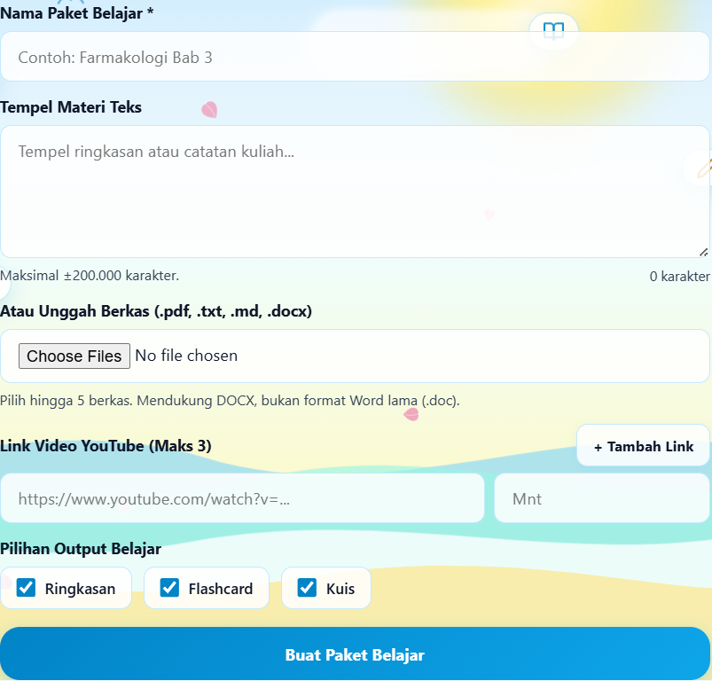

# ArsipBelajar

ArsipBelajar adalah aplikasi belajar berbasis web yang membantu mengubah materi menjadi ringkasan, flashcard, dan kuis. Aplikasi dibuat dengan HTML, CSS, dan JavaScript tanpa proses build atau backend sendiri.



## Fitur

- Buat paket belajar dari teks, berkas PDF/TXT/MD/DOCX, atau tautan video YouTube.
- Unggah maksimal lima berkas dan tambahkan maksimal tiga tautan YouTube untuk satu paket. Format Word lama `.doc` belum didukung.
- Pilih hasil yang ingin dibuat: ringkasan, flashcard, dan/atau kuis.
- Gunakan flashcard dengan pengulangan terjadwal berbasis sistem Leitner.
- Tanya Materi untuk bertanya tentang isi paket aktif, lalu simpan jawaban sebagai flashcard.
- Simpan nama panggilan di browser untuk sapaan dan personalisasi instruksi AI.
- Atur jumlah soal kuis dan pilih tanpa timer, timer total dalam menit, atau timer per soal dalam detik.
- Pilih Google Gemini atau Groq sebagai penyedia AI.
- Coba aplikasi dengan Mode Demo tanpa API key; hasilnya menggunakan data contoh.
- Ekspor dan impor paket belajar dalam format JSON, serta ekspor flashcard ke CSV.
- Pasang sebagai PWA dan buka kembali aplikasi untuk mempelajari materi yang tersimpan. Pembuatan materi dengan AI tetap memerlukan internet.

## Menjalankan secara lokal

Aplikasi menggunakan JavaScript ES Modules, jadi jalankan melalui web server lokal, bukan dengan membuka `index.html` langsung.

1. Pastikan Python tersedia.
2. Buka terminal di folder proyek.
3. Jalankan:

   ```bash
   python -m http.server 8080
   ```

   Di Windows, jika perintah `python` tidak ditemukan, coba `py -m http.server 8080`.

4. Buka [http://localhost:8080](http://localhost:8080) di browser.
5. Untuk menghentikan server, tekan `Ctrl+C` di terminal.

## Menyiapkan AI

Untuk membuat materi dengan AI, diperlukan koneksi internet dan API key dari penyedia yang dipilih. ArsipBelajar tidak menyertakan API key bersama aplikasi.

1. Buat key melalui [Google AI Studio](https://aistudio.google.com/apikey) atau [Groq Console](https://console.groq.com/keys).
2. Buka menu **Pengaturan**, pilih penyedia, tempel API key, lalu tekan **Simpan Pengaturan**.
3. Buka menu **Buat**, masukkan materi, pilih hasil yang diinginkan, lalu tekan **Buat Paket Belajar**.

Menu **Tutorial** memiliki pilihan terpisah untuk panduan penggunaan, mendapatkan API key Gemini, dan mendapatkan API key Groq. Pilihannya membuka panduan di bawah tombol dengan gulir halus. Groq mendukung materi teks dan dokumen; untuk analisis tautan YouTube gunakan Gemini.

Mode Demo dapat diaktifkan dari Pengaturan tanpa key, tetapi menghasilkan paket contoh dan bukan hasil dari materi yang dikirim ke AI. Ketersediaan model, kuota, dan ketentuan penggunaan ditentukan oleh penyedia AI. Groq menggunakan `openai/gpt-oss-20b` sebagai model bawaan; model yang tersedia dapat berubah.

## Alur belajar

1. Buat paket dari teks, berkas, atau tautan yang didukung.
2. Buka paket untuk membaca ringkasan, istilah penting, serta materi yang dihasilkan. Tab **Tanya Materi** menjawab berdasarkan teks sumber paket dan menyimpan riwayat secara terpisah per paket.
3. Gunakan **Flashcard** untuk mengingat materi. Jawab apakah kamu sudah mengingat kartu agar jadwal pengulangan diperbarui.
4. Pilih **Kuis** untuk menentukan jumlah soal dan pengaturan timer sebelum mulai.
5. Ekspor paket secara berkala sebagai cadangan.

### Nama panggilan

Saat pertama membuka situs, kamu bisa mengisi nama panggilan atau melewati langkah tersebut. Nama dapat diubah atau dihapus dari header aplikasi. Nama hanya disimpan di browser ini dan ditambahkan ke instruksi sistem AI sebagai data, bukan sebagai instruksi.

### Tanya Materi

Tanya Materi memakai API key Gemini yang sama dengan halaman **Pengaturan**, jadi key cukup dimasukkan sekali di sana dengan penyedia **Google Gemini**. Tombol **Pengaturan AI** pada tab Tanya Materi membuka halaman tersebut, sedangkan **Tes koneksi** memakai key yang sudah tersimpan. Key disimpan di localStorage browser ini dan dikirim langsung ke Gemini saat bertanya. Percakapan tidak disimpan di server ArsipBelajar. Materi hingga sekitar 8.000 kata dikirim utuh; materi yang lebih panjang dipilih menjadi empat potongan relevan (sekitar 400 kata per potongan dengan overlap 50 kata). Jawaban AI dapat ditambahkan ke paket sebagai flashcard.

Tes manual:

1. Tanpa key: buka Tanya Materi dan kirim pertanyaan; ajakan mengatur key harus muncul.
2. Key salah: tes koneksi atau kirim pertanyaan; pesan harus menjelaskan key tidak valid dan menyediakan **Coba lagi**.
3. Pertanyaan yang jawabannya ada di materi: jawaban harus singkat dan menyertakan kutipan materi.
4. Pertanyaan yang tidak ada di materi: jawaban harus menyatakan “Tidak ditemukan di materi”.
5. Pertanyaan lanjutan: tanyakan istilah di jawaban sebelumnya untuk memastikan konteks percakapan terbawa.
6. Materi lebih dari 8.000 kata: tanyakan konsep yang berada jauh di dalam materi dan pastikan jawaban mengambil potongan yang relevan.
7. Jaringan mati: kirim pertanyaan; pesan jaringan/CORS dan tombol **Coba lagi** harus tersedia.

## Penyimpanan dan privasi

- Paket belajar disimpan di IndexedDB pada browser dan perangkat yang sedang digunakan. Pengaturan, termasuk API key, disimpan di penyimpanan lokal browser.
- Saat pertama dibuka setelah rebranding, kunci localStorage berawalan `belajaryuk_` dipindahkan ke `arsipbelajar_`. Nama database IndexedDB tetap dipakai agar paket belajar lama tidak hilang.
- Riwayat Tanya Materi disimpan di localStorage secara terpisah untuk setiap paket.
- Data tidak disimpan di server ArsipBelajar dan tidak disinkronkan otomatis ke perangkat lain.
- Data situs dapat hilang jika penyimpanan browser dihapus, mode privat digunakan, atau penyimpanan browser tidak tersedia. Dalam kondisi tertentu, aplikasi memberi tahu bahwa paket hanya tersimpan sementara.
- Saat membuat paket, materi dan API key dikirim langsung dari browser ke penyedia AI yang dipilih. Gunakan API key sendiri dan jaga kerahasiaannya, terutama saat menggunakan perangkat bersama.
- Untuk mencadangkan materi, buka **Pengaturan → Cadangan & Ekspor Data** dan pilih **Unduh Semua Paket (JSON)**. Gunakan fitur impor untuk memulihkan cadangan.

## Menjalankan pengujian

Jalankan server lokal seperti dijelaskan di atas, lalu buka [http://localhost:8080/tests.html](http://localhost:8080/tests.html). Halaman tersebut menjalankan pengujian mandiri untuk penyimpanan, ekstraksi berkas, API, kuis, dan fitur lainnya.

## Teknologi

- HTML, CSS, JavaScript ES Modules
- IndexedDB dan LocalStorage
- Service Worker dan Web App Manifest (PWA)
- PDF.js untuk membaca PDF dan Mammoth.js untuk membaca DOCX, dimuat saat diperlukan
- Google Gemini API dan Groq API untuk pembuatan materi belajar

## Publikasi

ArsipBelajar dapat dipublikasikan sebagai situs statis, misalnya melalui GitHub Pages:

1. Unggah isi proyek ke repository GitHub.
2. Buka **Settings → Pages**.
3. Pada **Build and deployment**, pilih deploy dari branch, pilih branch publikasi (misalnya `main`) dan folder root.
4. Simpan pengaturan dan buka alamat Pages yang diberikan GitHub.

Situs yang dipublikasikan tidak otomatis memiliki API key untuk pengunjung. Setiap pengguna perlu memasukkan key sendiri atau mengaktifkan Mode Demo.

## Pengembang

- **Nama:** Muhammad Farrel
- **GitHub:** [NnoeeL](https://github.com/NnoeeL)
- **Instagram:** [@nnoelfr](https://www.instagram.com/nnoelfr/)
- **TikTok:** [@nno3el](https://www.tiktok.com/@nno3el)
- **Portofolio:** [nnoeel.github.io](https://nnoeel.github.io/)

## Lisensi

ArsipBelajar menggunakan lisensi MIT. Teks lengkap lisensi tersedia di [LICENSE](./LICENSE).
